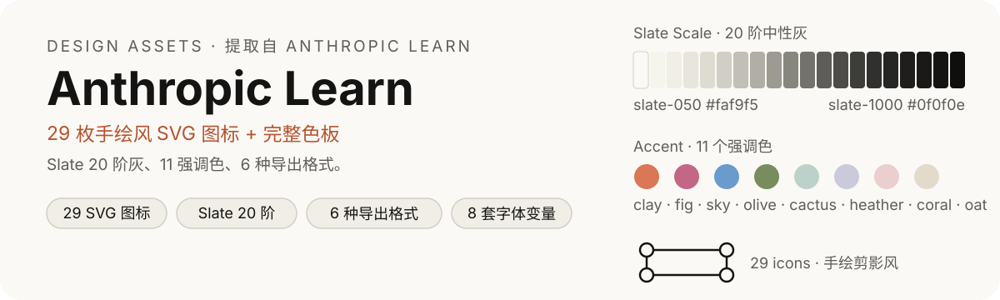
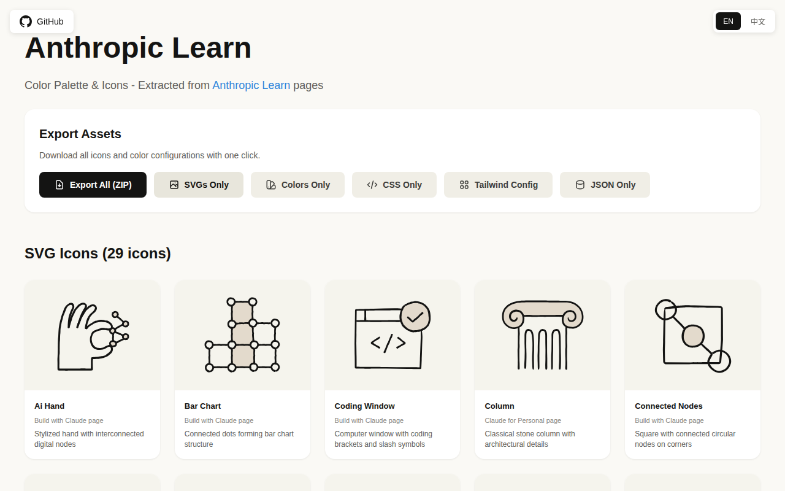
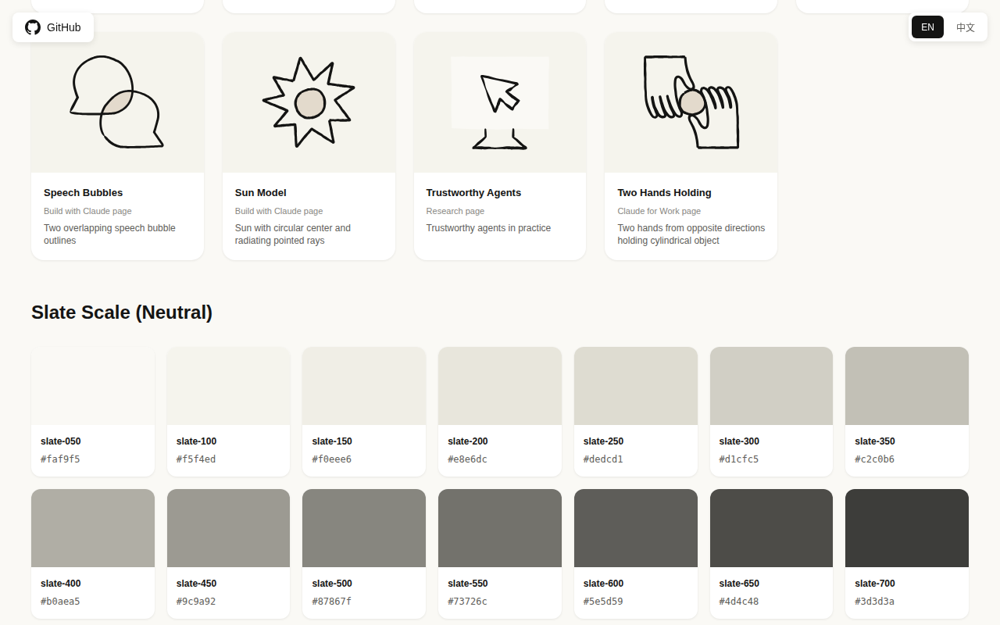

<p align="right"><a href="README.md">中文</a></p>

<p align="center">
  
</p>

<p align="center">
  <a href="https://xiaosang.cc/anthropic-learn-assets/">▶ Browse Online</a>
  ·
  <a href="https://holynova.github.io/anthropic-learn-assets/">GitHub Pages Mirror</a>
  ·
  <a href="https://github.com/holynova/anthropic-learn-assets">GitHub Repository</a>
</p>

Design assets extracted from Anthropic's public Learn pages: 29 hand-drawn-style SVG icons, a complete color system (20-step Slate neutrals, 11 accent colors, 2 semantic colors), and 8 font-family variables. Colors ship in 6 formats — CSS, SCSS, Tailwind, JSON, Figma, Android — and the showcase page exports everything as a ZIP in one click.

## Screenshots

<p align="center">
  
</p>

<p align="center">
  
</p>

## Contents

- **29 SVG icons** (`svgs/`): hand-drawn silhouette style, complex fill-based paths, no strokes or gradients, viewBox 500×500 or 1000×1000. Includes a hand with nodes, a light bulb, a quill, a seedling, puzzle pieces, a stone column, and more — plus `ANTHROPIC_ICON_STYLE_GUIDE.md`, a style analysis with AI image prompts for making more in the same style.
- **Slate neutrals, 20 steps**: slate-050 `#faf9f5` to slate-1000 `#0f0f0e`.
- **11 accent colors**: clay `#d97757`, fig `#c46686`, sky `#6a9bcc`, olive `#788c5d`, cactus `#bcd1ca`, heather `#cbcadb`, coral `#ebcece`, oat `#e3dacc`, plus light / dark / slate-dark.
- **2 semantic colors**: error `#bf4d43`, focus `#2c84db`.
- **8 font-family variables**: anthropicSans / anthropicSerif / anthropicMono / styreneA / styreneB / tiemposText / copernicus / jetBrainsMono.

## One-Click Export

Click a button at the top of the showcase page to download:

| Button | Contents |
|---|---|
| Export All (ZIP) | All SVGs + all color formats |
| SVGs Only | ZIP of the 29 icons |
| Colors Only | All color configurations |
| CSS Only | CSS custom properties |
| Tailwind Config | Tailwind color configuration |
| JSON Only | Simplified JSON palette |

## Usage

Reference any icon file under `svgs/` directly (e.g. `svgs/ai_hand.svg`), or inline it into a page.

Use the palette variables in CSS:

```css
.element {
  color: #d97757; /* clay */
  background-color: #faf9f5; /* slate-050 */
}
```

## Sources

The assets were extracted from these 6 public Anthropic pages:

- https://www.anthropic.com/learn
- https://www.anthropic.com/learn/build-with-claude
- https://www.anthropic.com/learn/claude-for-work
- https://www.anthropic.com/learn/claude-for-you
- https://www.anthropic.com/research
- https://www.anthropic.com/news

## Run Locally

A pure static showcase page — just open `index.html` to browse and export, no build step.

## Tech

- The showcase page is a single self-contained `index.html` (about 1.9MB, icons inlined); exports are packaged with JSZip.
- `color_palette.json` is the source of the palette, from which all 6 formats are generated.

```
index.html                  Interactive showcase (icon wall + palette + one-click export)
color_palette.json          Source of the palette and icon list
color/colors.json           Simplified JSON palette
css/colors.css              CSS custom properties
scss/colors.scss            SCSS variables
tailwind/colors.js          Tailwind configuration
figma/tokens.json           Figma design tokens
android/colors.xml          Android color resources
svgs/                       29 SVG icons
ANTHROPIC_ICON_STYLE_GUIDE.md   Icon style analysis and image-generation prompts
```

## Note

This project is for educational and reference purposes; assets were extracted from Anthropic's public web pages — please follow Anthropic's terms of service.
