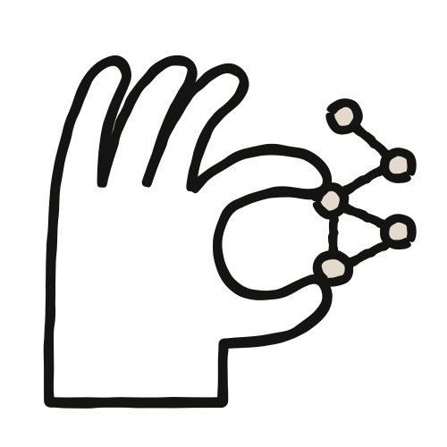

# Anthropic Learn - Color Palette & Icons

A collection of SVG icons and color palette extracted from Anthropic's Learn pages.

## Live Demo

**View the interactive showcase:** https://holynova.github.io/anthropic-learn-assets/

## Quick Export

Visit the demo page and use the **one-click export buttons** at the top to download:

- **Export All (ZIP)** - Complete package with all SVGs + all color formats
- **SVGs Only** - All 29 SVG icons in a ZIP file
- **Colors Only** - All color configurations (CSS, SCSS, Tailwind, JSON, Figma, Android)
- **CSS Only** - CSS custom properties
- **Tailwind Config** - Tailwind CSS color configuration
- **JSON Only** - Simple JSON color format

## Overview

This project contains visual design assets from [Anthropic Learn](https://www.anthropic.com/learn), including:

- **29 SVG icons** - Hand-drawn style illustrations used throughout the Learn pages
- **Color palette** - Complete color system including Slate scale, accent colors, and semantic colors
- **Typography** - Font family variables used in the design system

## Project Structure

```
anthropic_learn_assets/
├── README.md                 # This file
├── index.html                # Interactive HTML showcase with export buttons
├── color_palette.json       # Color palette in JSON format
├── css/
│   └── colors.css           # CSS custom properties
├── scss/
│   └── colors.scss          # SCSS/Sass variables
├── tailwind/
│   └── colors.js            # Tailwind CSS config
├── json/
│   └── colors.json          # Simple JSON format
├── figma/
│   └── tokens.json          # Figma design tokens format
├── android/
│   └── colors.xml           # Android XML resources
└── svgs/                    # Individual SVG icon files (29 total)
```

## Quick Start

### View Online

Visit the live demo: **https://holynova.github.io/anthropic-learn-assets/**

### View Locally

Clone the repository and open the HTML file:

```bash
git clone https://github.com/holynova/anthropic-learn-assets.git
cd anthropic-learn-assets
open index.html
```

## Export Formats

The project includes color configurations in multiple formats:

| Format | File | Description |
|--------|------|-------------|
| CSS | `css/colors.css` | CSS custom properties (`:root` variables) |
| SCSS | `scss/colors.scss` | SCSS/Sass variables with map |
| Tailwind | `tailwind/colors.js` | Tailwind CSS theme extension config |
| JSON | `json/colors.json` | Simple key-value JSON |
| Figma | `figma/tokens.json` | Figma design tokens format |
| Android | `android/colors.xml` | Android XML color resources |

## Pages Visited

The assets were extracted from the following Anthropic pages:

- https://www.anthropic.com/learn
- https://www.anthropic.com/learn/build-with-claude
- https://www.anthropic.com/learn/claude-for-work
- https://www.anthropic.com/learn/claude-for-you
- https://www.anthropic.com/research
- https://www.anthropic.com/news

## Color Palette

### Slate Scale (Neutral)

| Name | Hex | RGB |
|------|-----|-----|
| slate-050 | #faf9f5 | rgb(250, 249, 245) |
| slate-100 | #f5f4ed | rgb(245, 244, 237) |
| slate-150 | #f0eee6 | rgb(240, 238, 230) |
| slate-200 | #e8e6dc | rgb(232, 230, 220) |
| slate-250 | #dedcd1 | rgb(222, 220, 209) |
| slate-300 | #d1cfc5 | rgb(209, 207, 197) |
| slate-350 | #c2c0b6 | rgb(194, 192, 182) |
| slate-400 | #b0aea5 | rgb(176, 174, 165) |
| slate-450 | #9c9a92 | rgb(156, 154, 146) |
| slate-500 | #87867f | rgb(135, 134, 127) |
| slate-550 | #73726c | rgb(115, 114, 108) |
| slate-600 | #5e5d59 | rgb(94, 93, 89) |
| slate-650 | #4d4c48 | rgb(77, 76, 72) |
| slate-700 | #3d3d3a | rgb(61, 61, 58) |
| slate-750 | #30302e | rgb(48, 48, 46) |
| slate-800 | #262624 | rgb(38, 38, 36) |
| slate-850 | #1f1e1d | rgb(31, 30, 29) |
| slate-900 | #1a1918 | rgb(26, 25, 24) |
| slate-950 | #141413 | rgb(20, 20, 19) |
| slate-1000 | #0f0f0e | rgb(15, 15, 14) |

### Accent Colors

| Name | Hex | RGB |
|------|-----|-----|
| light | #ffffff | rgb(255, 255, 255) |
| dark | #0f0f0e | rgb(15, 15, 14) |
| slate-dark | #141413 | rgb(20, 20, 19) |
| oat | #e3dacc | rgb(227, 218, 204) |
| coral | #ebcece | rgb(235, 206, 206) |
| clay | #d97757 | rgb(217, 119, 87) |
| cactus | #bcd1ca | rgb(188, 209, 202) |
| fig | #c46686 | rgb(196, 102, 134) |
| sky | #6a9bcc | rgb(106, 155, 204) |
| olive | #788c5d | rgb(120, 140, 93) |
| heather | #cbcadb | rgb(203, 202, 219) |

### Semantic Colors

| Name | Hex | RGB |
|------|-----|-----|
| error | #bf4d43 | rgb(191, 77, 67) |
| focus | #2c84db | rgb(44, 132, 219) |

## SVG Icons (29 total)

The following SVG icons are available in the `svgs/` directory:

| Filename | Description | Source Page |
|----------|-------------|-------------|
| ai_hand.svg | Stylized hand with interconnected digital nodes | Build with Claude |
| bar_chart.svg | Connected dots forming bar chart structure | Build with Claude |
| coding_window.svg | Computer window with coding brackets and symbols | Build with Claude |
| column.svg | Classical stone column with architectural details | Claude for Personal |
| connected_nodes.svg | Square with connected circular nodes on corners | Build with Claude |
| cursor_nodes.svg | Cursor arrow with connected nodes | Build with Claude |
| document_icon.svg | Document icon with connected nodes on corners | Claude for Work |
| document_search.svg | Document with magnifying glass | Build with Claude |
| eye_hand.svg | Hand forming circle shape with eye symbol | Build with Claude |
| geometric_apis.svg | Geometric shapes including triangle and circle | Build with Claude |
| glasswing_logo.svg | Project Glasswing logo | News |
| grid_pattern.svg | Grid pattern with square element | Build with Claude |
| hand_flower_main.svg | Hand with organic flower petals emerging | Main Learn |
| hand_geometric.svg | Hand arranging geometric shapes | Build with Claude |
| hand_network_main.svg | Hand with connecting network nodes | Main Learn |
| hand_network_sm.svg | Hand with network nodes (smaller) | Claude for Work |
| infographic.svg | Infographic with geometric shapes | Claude for Work |
| lightbulb.svg | Light bulb with star-shaped filament | Build with Claude |
| magnifying_glass.svg | Magnifying glass with connected nodes | Claude for Work |
| pencil_nodes.svg | Pencil connecting two circular nodes | Build with Claude |
| puzzle_piece.svg | Interlocking puzzle piece | Build with Claude |
| puzzle_piece_main.svg | Puzzle piece with complex geometry | Main Learn |
| quill_pen.svg | Ornate quill pen with detailed handle | Claude for Work |
| seedling.svg | Young plant seedling with leaves | Build with Claude |
| seedling_work.svg | Young plant seedling | Claude for Work |
| speech_bubbles.svg | Two overlapping speech bubble outlines | Build with Claude |
| sun_model.svg | Sun with circular center and radiating rays | Build with Claude |
| trustworthy_agents.svg | Trustworthy agents illustration | Research |
| two_hands_holding.svg | Two hands holding cylindrical object | Claude for Work |

## Usage

### View the Interactive Demo

Open `index.html` in any modern web browser or visit:
**https://holynova.github.io/anthropic-learn-assets/**

### Use Individual SVG Icons

Each SVG icon can be found in the `svgs/` directory and used independently:

```html

```

Or inline:

```html
<svg xmlns="http://www.w3.org/2000/svg" viewBox="0 0 500 500">
  <!-- SVG content -->
</svg>
```

### Use Colors in CSS

```css
.element {
  color: #d97757; /* clay */
  background-color: #faf9f5; /* slate-050 */
  border-color: #87867f; /* slate-500 */
}
```

### Use Colors in Tailwind

```js
// tailwind.config.js
module.exports = {
  theme: {
    extend: {
      colors: {
        clay: '#d97757',
        slate: {
          50: '#faf9f5',
          // ...
        }
      }
    }
  }
}
```

## Deployment

This project uses GitHub Actions to automatically deploy to GitHub Pages on every push to `main`.

- **Live Demo:** https://holynova.github.io/anthropic-learn-assets/
- **GitHub Pages Settings:** https://github.com/holynova/anthropic-learn-assets/settings/pages

## License

This project is for educational and reference purposes. All assets are extracted from Anthropic's publicly available web pages. Please refer to Anthropic's terms of service for usage guidelines.

## Credits

- Design assets extracted from [Anthropic](https://www.anthropic.com)
- Visit [Anthropic Learn](https://www.anthropic.com/learn) for more information
