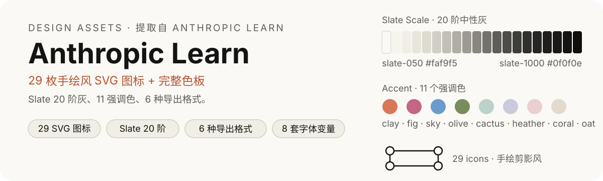
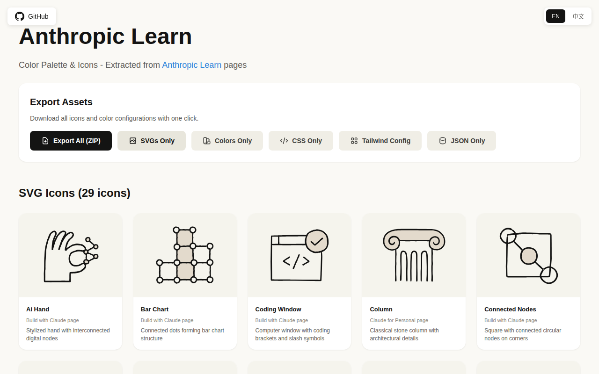
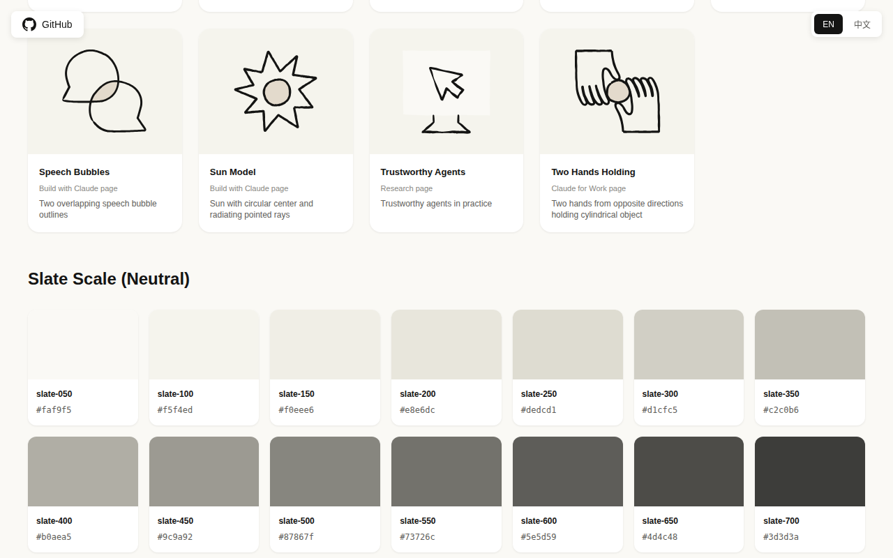

<p align="center">
  
</p>

<p align="center">
  <a href="https://xiaosang.cc/anthropic-learn-assets/">▶ 在线浏览 Browse Online</a>
  ·
  <a href="https://holynova.github.io/anthropic-learn-assets/">GitHub Pages 备选镜像</a>
  ·
  <a href="https://github.com/holynova/anthropic-learn-assets">GitHub 仓库</a>
</p>

从 Anthropic Learn 公开页面提取的设计素材：29 枚手绘风 SVG 图标 + 完整色板（Slate 20 阶中性灰、11 个强调色、2 个语义色）+ 8 套字体变量。色板提供 CSS / SCSS / Tailwind / JSON / Figma / Android 6 种格式，展示页可一键导出 ZIP。

Design assets extracted from Anthropic's public Learn pages: 29 hand-drawn-style SVG icons, a complete color system (20-step Slate neutrals, 11 accent colors, 2 semantic colors), and 8 font-family variables. Colors ship in 6 formats — CSS, SCSS, Tailwind, JSON, Figma, Android — and the showcase page exports everything as a ZIP in one click.

## 截图 / Screenshots

<p align="center">
  
</p>

<p align="center">
  
</p>

## 内容 / Contents

- **29 枚 SVG 图标**（`svgs/`）：手绘剪影风，复杂 `<path>` 填充、无描边、无渐变，viewBox 500×500 或 1000×1000。包括手与节点、灯泡、羽毛笔、幼苗、拼图、石柱等，另附 `ANTHROPIC_ICON_STYLE_GUIDE.md` 风格分析与同风格 AI 生图提示词。
- **Slate 中性灰 20 阶**：slate-050 `#faf9f5` 到 slate-1000 `#0f0f0e`。
- **强调色 11 个**：clay `#d97757`、fig `#c46686`、sky `#6a9bcc`、olive `#788c5d`、cactus `#bcd1ca`、heather `#cbcadb`、coral `#ebcece`、oat `#e3dacc`，另加 light / dark / slate-dark。
- **语义色 2 个**：error `#bf4d43`、focus `#2c84db`。
- **字体变量 8 套**：anthropicSans / anthropicSerif / anthropicMono / styreneA / styreneB / tiemposText / copernicus / jetBrainsMono。

## 一键导出 / One-Click Export

在展示页顶部点按钮即可下载：

| 按钮 | 内容 |
|---|---|
| Export All (ZIP) | 全部 SVG + 全部色板格式 |
| SVGs Only | 29 枚图标 ZIP |
| Colors Only | 全部色板配置 |
| CSS Only | CSS 自定义属性 |
| Tailwind Config | Tailwind 颜色配置 |
| JSON Only | 简化 JSON 色板 |

## 使用 / Usage

直接引用 `svgs/` 下的任意图标文件（如 `svgs/ai_hand.svg`），或内联进页面。

CSS 里用色板变量：

```css
.element {
  color: #d97757; /* clay */
  background-color: #faf9f5; /* slate-050 */
}
```

## 来源页面 / Sources

素材提取自以下 6 个 Anthropic 公开页面：

- https://www.anthropic.com/learn
- https://www.anthropic.com/learn/build-with-claude
- https://www.anthropic.com/learn/claude-for-work
- https://www.anthropic.com/learn/claude-for-you
- https://www.anthropic.com/research
- https://www.anthropic.com/news

## 本地运行 / Run Locally

纯静态展示页，直接打开 `index.html` 即可浏览与导出，无需构建。

## 技术 / Tech

- 展示页是单个自包含 `index.html`（约 1.9MB，图标内联），导出用 JSZip 打包。
- 色板以 `color_palette.json` 为源头，同步生成 6 种格式。

```
index.html                  交互展示页（图标墙 + 色板 + 一键导出）
color_palette.json          色板与图标清单源头
color/colors.json           简化 JSON 色板
css/colors.css              CSS 自定义属性
scss/colors.scss            SCSS 变量
tailwind/colors.js          Tailwind 配置
figma/tokens.json           Figma 设计令牌
android/colors.xml          Android 颜色资源
svgs/                       29 枚 SVG 图标
ANTHROPIC_ICON_STYLE_GUIDE.md   图标风格分析与生图提示词
```

## English

**Anthropic Learn Assets** collects design assets extracted from Anthropic's public Learn pages: 29 hand-drawn silhouette SVG icons, a 20-step Slate neutral scale (`#faf9f5`–`#0f0f0e`), 11 accent colors, 2 semantic colors, and 8 font-family variables.

- **Icons**: fill-based complex paths, no strokes or gradients, viewBox 500×500 or 1000×1000. A style guide (`ANTHROPIC_ICON_STYLE_GUIDE.md`) analyzes the look and gives AI image prompts for making more in the same style.
- **Export**: the showcase page offers one-click downloads — full ZIP, SVGs only, colors only, CSS only, Tailwind config, or JSON only.
- **Formats**: colors ship as CSS custom properties, SCSS variables, a Tailwind config, JSON, Figma tokens, and Android XML.
- **Run it**: open `index.html` — a single self-contained page, no build step.

## 说明 / Note

本仓库仅供学习与参考。素材提取自 Anthropic 公开页面，使用请遵守 Anthropic 服务条款。This project is for educational and reference purposes; assets were extracted from Anthropic's public web pages — please follow Anthropic's terms of service.
